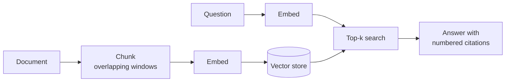

# rag-starter

[](https://github.com/numankhan4/rag-starter/actions/workflows/ci.yml)


A small, readable **retrieval-augmented generation (RAG)** starter: ingest documents, retrieve the most relevant
chunks, and answer questions **with citations** — FastAPI backend, Next.js frontend.

It runs fully offline out of the box (deterministic hashing embeddings + extractive answers), so you can read,
test and extend every step before plugging in real models like Claude or a vector database.

## How it works



| Step | Default (offline) | Pluggable via |
| --- | --- | --- |
| Chunking | word windows with overlap | `app/chunking.py` |
| Embeddings | `HashingEmbedder` (feature hashing, L2-normalised) | `Embedder` protocol |
| Vector store | `InMemoryVectorStore` (cosine similarity) | store interface |
| Answering | `ExtractiveAnswerer` (best sentences + `[n]` citations) | `Answerer` protocol |

## Quick start

```bash
# Docker
docker compose up --build        # web: http://localhost:3000  api: http://localhost:8000/docs

# or locally (Python 3.10+, Node 22+)
bash scripts/setup-dev.sh
(cd backend && uvicorn app.main:app --reload)
(cd frontend && npm run dev)
```

## API

| Method | Path | Body | Returns |
| --- | --- | --- | --- |
| `POST` | `/ingest` | `{ doc_id, text, title? }` | `{ doc_id, chunks }` — re-ingesting replaces the document |
| `POST` | `/query` | `{ question, k? }` | `{ answer, citations, sources[] }` |
| `DELETE` | `/documents/{doc_id}` | — | `{ removed_chunks }` |
| `GET` | `/health` | — | `{ status, chunks, documents }` |

## Configuration

The backend reads these optional environment variables (see `backend/app/settings.py`); invalid values fail at startup.

| Variable | Default | Meaning |
| --- | --- | --- |
| `CORS_ORIGINS` | `http://localhost:3000` | Comma-separated allowed origins |
| `CHUNK_SIZE` | `120` | Words per chunk |
| `CHUNK_OVERLAP` | `20` | Words shared between chunks (< `CHUNK_SIZE`) |
| `TOP_K` | `4` | Default number of sources when `/query` omits `k` (1–20) |
| `EMBEDDER` | `hashing` | Embedding provider (only `hashing`, offline, for now) |
| `ANSWERER` | `extractive` | Answer provider (only `extractive`, offline, for now) |

## Development

```bash
bash scripts/check.sh   # ruff + pytest + typecheck + tests + production build
```

See [ROADMAP.md](ROADMAP.md) for what's next.

## How this repo is built

Like [wp-headless-kit](https://github.com/numankhan4/wp-headless-kit), this project doubles as a demo of an
AI-assisted engineering workflow I designed: a daily GitHub Action picks the next roadmap issue, Claude implements
it with tests and opens a PR, an AI review comments on it, CI must pass, and code changes are reviewed and merged
by me. Commits carry a `Co-authored-by: Claude` trailer. The workflows are in [`.github/workflows`](.github/workflows).

## License

MIT © Numan Ul Haq
